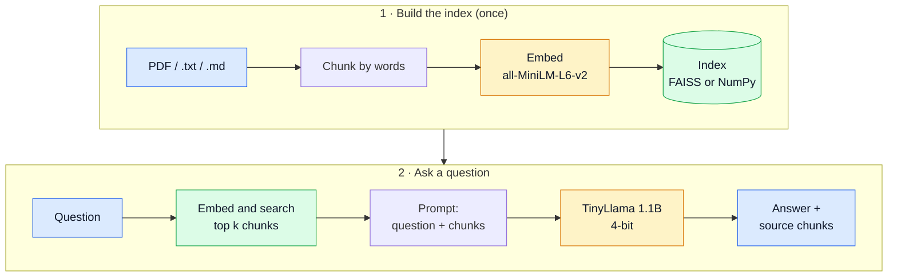

# Tiny RAG

A minimal Python library and example notebook for RAG (TinyLlama + FAISS + sentence-transformers) that runs in under 1 GB of GPU memory.



[](https://colab.research.google.com/github/didiergarcia/tiny-rag/blob/main/examples/tiny-rag.ipynb)
[](https://github.com/didiergarcia/tiny-rag/actions/workflows/ci.yml)

This started as a learning project. The notebook asks a small model about an event after its training cutoff, sees that it doesn't know, and fixes the answer with retrieval-augmented generation (RAG) over a one-page PDF. The same steps are packaged as a small library, `tiny_rag`.

## What this shows

- **4-bit quantized generation** with `transformers` and `bitsandbytes`: [TinyLlama-1.1B-Chat-v1.0](https://huggingface.co/TinyLlama/TinyLlama-1.1B-Chat-v1.0) loaded in NF4 with double quantization, prompted through the model's own chat template.
- **Embeddings** with `sentence-transformers` ([all-MiniLM-L6-v2](https://huggingface.co/sentence-transformers/all-MiniLM-L6-v2)).
- **A FAISS index** for finding the chunks closest to a question, with a NumPy fallback when FAISS isn't installed.
- **Small memory use.** Measured in the notebook: the 4-bit model takes 0.70 GB, and peak GPU memory for the notebook's step-by-step pipeline is 0.89 GB (RTX 5090).

## The library

```python
from tiny_rag import RAG, HFTransformersLLM, Index

index = Index.from_files(["data/2024–25_NFL_playoffs_pg_1.pdf"], chunk_size=150)
rag = RAG(index, HFTransformersLLM(load_in_4bit=True))

answer = rag.ask("Who won the 2024 NFL Championship?", k=2)
print(answer.text)
for hit in answer.sources:
    print(f"{hit.score:.3f}  {hit.chunk.source}")

index.save("nfl-index")  # later: Index.load("nfl-index")
```

Output from a run on an RTX 5090:

```
The 2024 NFL Championship was won by the Philadelphia Eagles, who defeated the defending champion Kansas City Chiefs 40-22 in the Super Bowl LIX at Caesars Superdome in New Orleans, Louisiana.
0.596  data/2024–25_NFL_playoffs_pg_1.pdf#page=1
0.499  data/2024–25_NFL_playoffs_pg_1.pdf#page=1
```

The API:

| | |
|---|---|
| `Index.from_texts(texts, embedder=..., chunk_size=150, overlap=0)` | Chunk strings by words and embed them. |
| `Index.from_files(paths, ...)` | The same for `.txt`, `.md` and `.pdf` files (pypdf). Each PDF page is its own source, `path#page=N`. |
| `index.search(query, k)` | Up to `k` `Hit`s, most similar first. A hit has the chunk, its source and a cosine-similarity score. |
| `index.save(path)` / `Index.load(path)` | Store the chunks and vectors in a directory. |
| `RAG(index, llm).ask(question, k=4)` | An `Answer` with the model's text and the chunks that were put into its prompt. |
| `HFTransformersLLM(model, load_in_4bit=False)` | A local Hugging Face chat model. TinyLlama by default; 4-bit needs an NVIDIA GPU. |
| `OpenAICompatibleLLM(base_url, model)` | Any OpenAI-style `/chat/completions` server, such as vLLM or the llama.cpp server. |

The embedder and the LLM are small protocols: any object with `name` and `embed(texts)` can embed, and any object with `generate(messages, max_new_tokens)` can answer.

### Install

Not on PyPI. Install from GitHub:

```bash
pip install "tiny-rag[faiss] @ git+https://github.com/didiergarcia/tiny-rag"         # CPU or GPU
pip install "tiny-rag[faiss,quant] @ git+https://github.com/didiergarcia/tiny-rag"   # plus 4-bit (NVIDIA GPU)
```

Python 3.10 or newer. The core needs numpy, pypdf and sentence-transformers (which brings in PyTorch and transformers).

## Evaluation

`examples/eval.py` asks 20 questions about the sample page and checks the results against accepted answers. The author wrote the questions and answers from the PDF text. It is a smoke test of one small document, not a benchmark.

Results from one run (2026-11-20, RTX 5090, TinyLlama 4-bit, greedy decoding, 50-word chunks with 10-word overlap giving 12 chunks, k = 3):

| Metric | Result |
|---|---|
| Retrieval hit@1: an accepted answer appears in the top chunk | 12/20 |
| Retrieval hit@3: an accepted answer appears in one of the top 3 chunks | 17/20 |
| Answer contains an accepted answer | 12/20 |
| Answer exact match | 0/20 |

Exact match is 0 because TinyLlama answers in full sentences. Typical misses: it gives the score as 52-22 instead of 40-22, calls the second round "Wild Card", and names the wrong team for several playoff seeds. Retrieval hits only check that the answer text is somewhere in a retrieved chunk.

```bash
python examples/eval.py            # needs an NVIDIA GPU for 4-bit
python examples/eval.py --no-4bit  # no quantization (bf16)
```

## Quickstart

### Notebook in Colab

1. Click **Open in Colab** above.
2. Choose a GPU runtime: Runtime → Change runtime type → T4 GPU.
3. Run all cells. The notebook installs pinned packages and downloads the sample PDF itself.

### Notebook locally

You need an NVIDIA GPU with CUDA, because bitsandbytes 4-bit loading does not run on CPU.

```bash
git clone https://github.com/didiergarcia/tiny-rag.git
cd tiny-rag
python -m venv .venv && source .venv/bin/activate
pip install -r requirements.txt jupyter
jupyter notebook examples/tiny-rag.ipynb
```

`requirements.txt` pins the versions that ran the notebook top to bottom on Ubuntu 24.04 with Python 3.12 and an RTX 5090.

### Hugging Face Space

`spaces/` holds a Gradio app and Space metadata. It runs on CPU without quantization. See [spaces/README.md](spaces/README.md).

## Development

```bash
pip install -e ".[faiss,dev]"
ruff check . && ruff format --check .
pytest
```

The tests use a fake embedder and a fake LLM, so they run on CPU without downloading models. The OpenAI-compatible backend is tested against a local mock HTTP server. `HFTransformersLLM` is not covered by the tests; it was checked by running the examples. CI runs lint and the tests on Python 3.10, 3.11 and 3.12.

## Limitations

- The sample data is one page of one document, and the evaluation has 20 questions.
- Chunking splits on words; it does not follow sentences or sections.
- `RAG.ask` returns the chunks it gave the model, but the model does not cite them, and answers can still be wrong (see Evaluation).
- 4-bit loading needs an NVIDIA GPU. Without it the model loads unquantized in bf16, which took 2.05 GB.
- The index is in memory and searched exhaustively, which suits small document sets.
- Answers come from greedy decoding and can differ with other package versions or hardware.

## Project structure

```
tiny-rag/
├── src/tiny_rag/           # The library
├── tests/                  # pytest suite (no model downloads)
├── examples/
│   ├── tiny-rag.ipynb      # Step-by-step notebook, then the same thing with the library
│   ├── quickstart.py       # The example above
│   └── eval.py             # 20-question evaluation
├── spaces/                 # Gradio app for a Hugging Face Space
├── data/                   # Sample PDF and its source and license
├── requirements.txt        # Pinned versions for the notebook
├── pyproject.toml
└── CHANGELOG.md
```

## Resources

- [TinyLlama paper](https://arxiv.org/abs/2401.02385)
- [FAISS](https://github.com/facebookresearch/faiss)
- [Sentence Transformers](https://www.sbert.net/)
- [bitsandbytes quantization in transformers](https://huggingface.co/docs/transformers/main/en/quantization/bitsandbytes)

## License

The code is MIT licensed (see [LICENSE](LICENSE)). The sample PDF is Wikipedia content under CC BY-SA 4.0 (see [data/README.md](data/README.md)). The notebook's step-by-step section uses PyMuPDF, which is licensed under AGPL-3.0; the library uses pypdf (BSD) instead.
