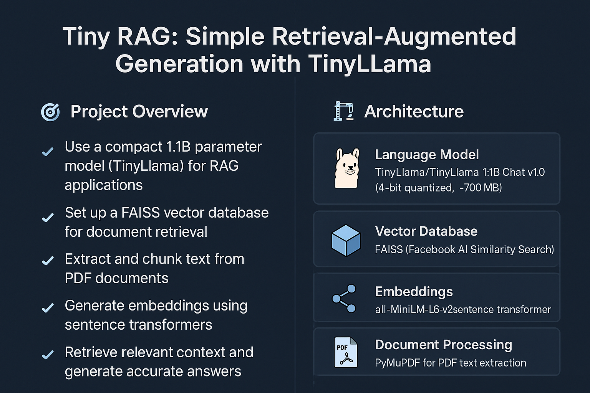

# Tiny RAG: Simple Retrieval-Augmented Generation with TinyLlama


This project demonstrates how to build a simple RAG (Retrieval-Augmented Generation) system using a small language model (TinyLlama-1.1B-Chat-v1.0) and FAISS vector database to answer questions about events that occurred after the model's knowledge cutoff date.

At just 1.1B parameters, TinyLlama is approximately 70x smaller than Llama 2 (70B) and approximately 80x smaller than Llama 3 (80B) while still maintaining impressive performance for many tasks. This makes it ideal for resource-constrained environments or rapid prototyping of RAG systems.

## 🎯 Project Overview

The project showcases how to:
- Use a compact 1.1B parameter model (TinyLlama) for RAG applications
- Set up a FAISS vector database for document retrieval
- Extract and chunk text from PDF documents
- Generate embeddings using sentence transformers
- Retrieve relevant context and generate accurate answers

## 🏗️ Architecture

- **Language Model**: TinyLlama/TinyLlama-1.1B-Chat-v1.0 (4-bit quantized, ~700MB)
- **Vector Database**: FAISS (Facebook AI Similarity Search)
- **Embeddings**: all-MiniLM-L6-v2 sentence transformer
- **Document Processing**: PyMuPDF for PDF text extraction

## 📋 Prerequisites

- Google Colab (recommended) or local Python environment
- Python 3.8+
- GPU support (optional but recommended for faster inference)

## 🚀 Quick Start

### 1. Prepare Your PDF Document

**For Google Colab:**
1. Create a `data` folder in your Google Colab workspace
2. Upload the `./data/2024–25_NFL_playoffs_pg_1.pdf` PDF file using the file upload interface
3. Ensure the PDF is accessible at `./data/2024–25_NFL_playoffs_pg_1.pdf`

**For Local Development:**
1. Create a `data` folder in your project directory if it doesn't exist
2. Place the `./data/2024–25_NFL_playoffs_pg_1.pdf` PDF file in the `./data/` directory
3. Update the notebook to read the PDF from the appropriate location.


### 2. Update the PDF Path

In the notebook, update the PDF path to match your file name:

```python
# For local development (relative path)
pdf_text = "\n".join(block[4] for block in fitz.open("./data/your_document.pdf").load_page(0).get_text("blocks"))

# For Google Colab (absolute path)
pdf_text = "\n".join(block[4] for block in fitz.open("/content/data/your_document.pdf").load_page(0).get_text("blocks"))
```

**Important:** Replace `your_document.pdf` with the actual name of your PDF file.

### 3. Install Dependencies

The notebook will automatically install the required packages:

```bash
pip install transformers sentence_transformers faiss-cpu bitsandbytes PyMuPDF
```

### 4. Run the Notebook

1. Open `tiny-rag.ipynb` in Google Colab or your local Jupyter environment
2. Run all cells sequentially
3. The system will:
   - Load the TinyLlama model
   - Extract text from your PDF in the `./data/` directory
   - Create embeddings and store them in FAISS
   - Demonstrate RAG functionality with example queries

## 📁 Project Structure

```
tiny-rag/
├── README.md
├── tiny-rag.ipynb          # Main notebook with RAG implementation
├── assets/
│   └── tiny-rag.png        # Architecture diagram
└── data/
    ├── 2024–25_NFL_playoffs_pg_1.pdf  # Example PDF document
    └── your_document.pdf              # Add your PDFs here
```

## 🔧 Key Components

### Model Setup
- Uses 4-bit quantization for memory efficiency
- Loads TinyLlama-1.1B-Chat-v1.0 model (~700MB on disk, ~1GB RAM)
- Configured for conversational chat format

### Document Processing
- Extracts text from PDF using PyMuPDF
- Chunks text into smaller segments (150 words per chunk)
- Creates embeddings for each chunk using sentence transformers

### Vector Database
- FAISS IndexFlatL2 for L2 distance similarity search
- Stores document embeddings for fast retrieval
- Returns top-k most similar chunks for context

### RAG Pipeline
1. **Query**: User asks a question
2. **Retrieval**: System finds relevant document chunks
3. **Generation**: Model generates answer using retrieved context

## 💡 Example Usage

The notebook demonstrates the RAG system with an NFL championship question:

**Without RAG (Model hallucination):**
```
Q: Who won the 2024 NFL Championship?
A: The Los Angeles Rams (incorrect)
```

**With RAG (Accurate answer):**
```
Q: Who won the 2024 NFL Championship?
A: The Philadelphia Eagles defeated the Kansas City Chiefs 40-22 in Super Bowl LIX
```

## 🎛️ Configuration

### Model Parameters
- **Model**: TinyLlama/TinyLlama-1.1B-Chat-v1.0
- **Quantization**: 4-bit (nf4)
- **Compute dtype**: bfloat16
- **Max tokens**: 300 (configurable)

### Chunking Parameters
- **Chunk size**: 150 words (configurable)
- **Overlap**: None (can be added for better context)

### Retrieval Parameters
- **Top-k**: 3 chunks (configurable)
- **Similarity metric**: L2 distance

## 📊 Performance

- **Model Size**: ~700MB (4-bit quantized)
- **Memory Usage**: ~1GB RAM
- **Inference Speed**: Fast on GPU, moderate on CPU
- **Accuracy**: Good for factual questions with proper context

### Performance Tips

- Use GPU acceleration when available
- Adjust chunk size based on your document characteristics
- Consider using multiple smaller documents instead of one large document

## 📚 Resources

- [TinyLlama Paper](https://arxiv.org/abs/2401.02385)
- [FAISS Documentation](https://github.com/facebookresearch/faiss)
- [Sentence Transformers](https://www.sbert.net/)
- [PyMuPDF Documentation](https://pymupdf.readthedocs.io/)

## 📄 License

This project is open source and available under the MIT License.

---

**Note**: This project is for educational purposes and demonstrates the basic concepts of RAG systems. For production use, consider more robust solutions with better error handling, security, and scalability features. 